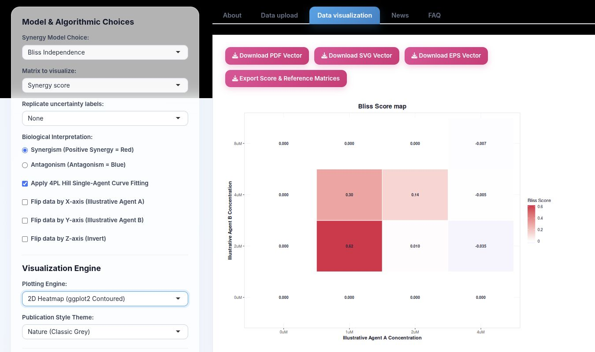
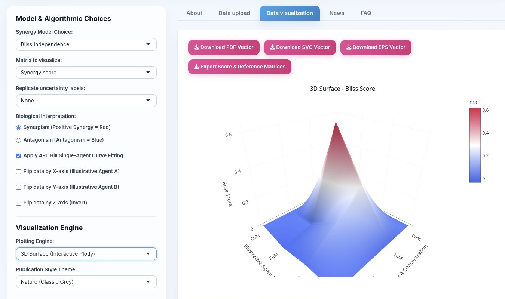
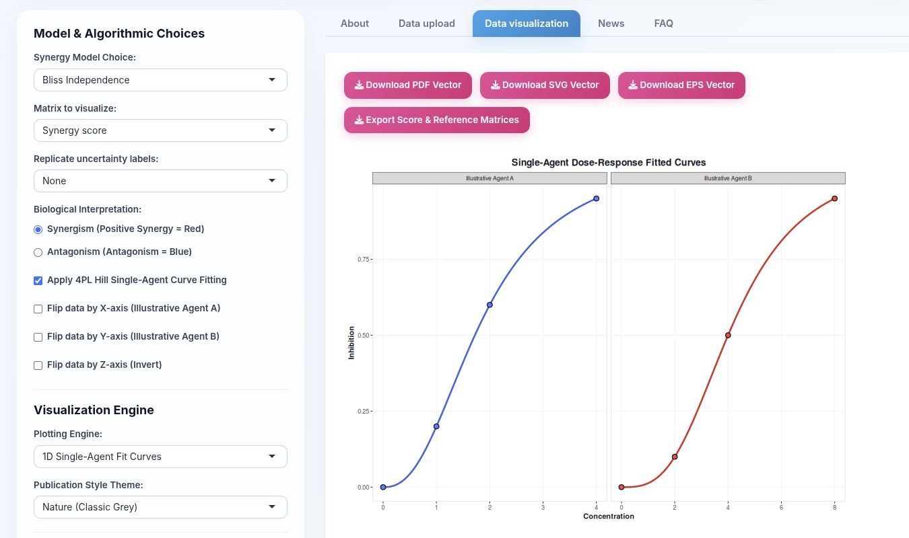
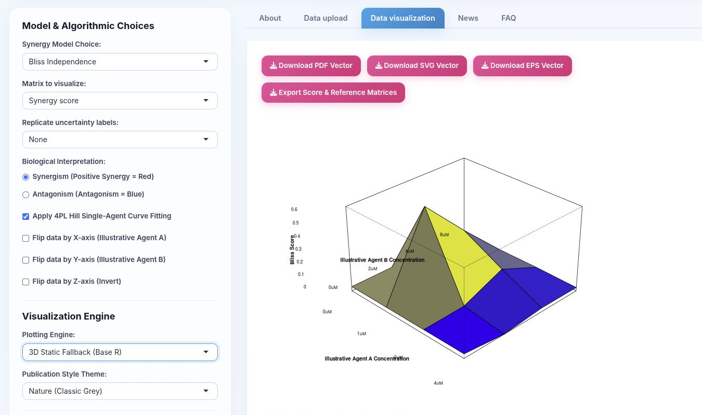

# Plots and visualization settings

All screenshots below show the same illustrative synergistic matrix with Bliss scoring. Red values represent positive synergy in the selected *Synergism* orientation. Screenshots are cropped to one graph and the controls that determine it.

## 2D contoured heatmap



The 2D heatmap is the best general-purpose view. Each tile is one dose pair; its colour and text label show the selected matrix value. It is suitable for locating local synergy or antagonism, checking boundaries and exporting a figure for a report.

- **Synergy score:** observed inhibition minus the model-specific non-interaction reference.
- **Reference effect:** the inhibition predicted under the selected no-interaction model.
- **Observed inhibition:** the normalized or baseline-adjusted experimental response.
- **Replicate uncertainty labels:** none, mean ± SEM or bootstrap 95% CI.
- Use **Synergism** when positive deviations should be emphasized in red; use **Antagonism** when negative deviations should be emphasized in blue.

## Interactive 3D Plotly surface



The interactive surface shows the same matrix as height and colour. Peaks identify positive deviations and valleys identify negative deviations. Hovering reports the dose pair and value. This plot is useful for exploring a response landscape, but the 2D heatmap is usually better for exact comparisons.

The camera controls appear for both 3D engines:

- **Rotation (Azimuth), 0–360°:** rotates around the vertical axis.
- **Elevation (Altitude), −90–90°:** changes the viewing angle above or below the surface.
- **Zoom (Distance), 0.5–3.0:** changes camera distance.

Record these values when reproducing a figure.

## Single-agent 4PL curves



This view plots the two zero-partner-dose series and their fitted four-parameter logistic curves. Use it before trusting model-dependent scores:

- Confirm that each single-agent series spans a meaningful response range.
- Look for non-monotonicity, sparse points or a poorly constrained midpoint.
- Compare the fitted curve with the observations before relying on IC50, Loewe or ZIP results.
- Clear **Apply 4PL Hill Single-Agent Curve Fitting** to use monotonic interpolation instead of the fitted curves.

This plot does not display combination wells; it diagnoses the marginal curves used by the response-surface calculations.

## Static Base R 3D surface



The static surface provides a non-interactive 3D fallback and is useful for deterministic vector export. It uses the selected rotation and elevation settings. Because perspective can hide cells, accompany a 3D figure with a 2D heatmap or exported matrix.

## Dose-pair synergy barometer

The barometer appears below the summary table. Select an Agent A concentration and an Agent B concentration to compare the observed inhibition at that well with the HSA, Bliss, Loewe, ZIP and consensus reference effects. The plotted delta is:

```text
delta = observed inhibition - reference inhibition
```

A positive delta indicates more inhibition than predicted by that model; a negative delta indicates less. The accompanying table provides full-precision reference, observed and delta values. This is the clearest way to explain why two models disagree at a particular dose pair.

## Settings shared by the plots

### Synergy model

Choose Bliss, HSA, Loewe, ZIP, conservative consensus or raw input data. See [Algorithms and scientific references](Algorithms-and-references.md) for the null hypothesis behind each choice.

### Matrix to visualize

| Choice | Displayed quantity |
|---|---|
| Synergy score | `observed - reference`; positive means excess inhibition |
| Reference effect | Expected inhibition if the selected null model holds |
| Observed inhibition | Experimental inhibition after normalization and optional baseline correction |

ZIP additionally calculates a fitted combination-response surface, which is included in the matrix export.

### 4PL fitting

When enabled, four-parameter logistic curves provide continuous single-agent predictions and inverse dose estimates. When a stable fit is unavailable, CheckerboardR falls back to monotonic linear interpolation. The raw observations are not overwritten.

### Axis controls

- **Flip X:** reverses the Agent A display order.
- **Flip Y:** reverses the Agent B display order.
- **Flip Z:** inverts plotted heights/signs for an alternative perspective.

These are display transformations. They do not alter the uploaded measurements or exported underlying matrices.

### Publication themes

| Theme | Intended appearance |
|---|---|
| Nature | Classic grey/Arial |
| Science | High-contrast white/Helvetica |
| The Economist | Light blue/Trebuchet MS |
| Financial Times | Warm salmon/Georgia |

### Labels and export size

Enable **Customize Labels & Title** to set the Agent A axis, Agent B axis and plot title. Enable **Adjust Export Dimensions** to set output width and height (minimum 200 px). PDF, SVG and EPS are preferred for publication; use PNG for slides or web documentation.

